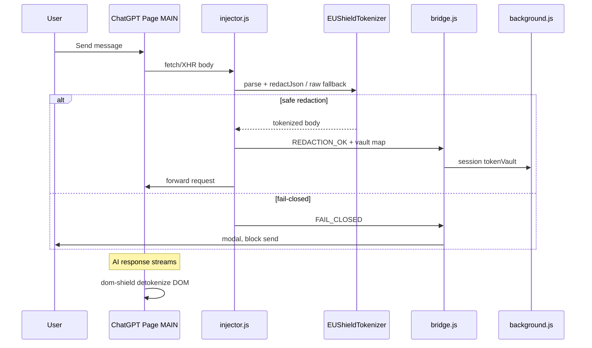

# EUShield (AnonymX) — kompletan projekatni brief za AI / novog saradnika

> **Verzija dokumenta:** novembar 2026  
> **Autor proizvoda / kontakt:** Bane dev, Belgrade, Serbia — `bane.madjija@gmail.com`  
> **Svrha ovog fajla:** uvesti drugog GPT-a ili developera u celu pri?u — proizvod, arhitektura, kod, dizajn, marketing i operativa.

---

## 1. Elevator pitch

**EUShield** (interno ponekad **AnonymX**) je **B2B Chromium ekstenzija (Manifest V3)** + **marketing landing sajt** za firme u EU koje koriste **ChatGPT** i **Claude** u browseru, a ne žele da **PII** (li?ni podaci, IBAN, plate, mejlovi…) ode u **plain text** ka US inference API-jima.

**Klju?na obe?anja:**

- **100% lokalna obrada** — nema servera koji ?uva PII.
- **Tokenizacija pre slanja** — osetljivi delovi postaju placeholderi tipa `[NAME_1]`, `[IBAN_2]`.
- **Fail-closed** — ako parse/tokenize ne može bezbedno, **šalj se blokira** (modal, zahtev se ne prosle?uje).
- **De-tokenizacija u UI** — zaposleni i dalje vidi „ljudska” imena u odgovorima AI-ja (TreeWalker), dok **Copy Clean** kopira verziju sa tokenima.
- **GDPR Chapter V + EU AI Act** narativ na sajtu (nije pravni savet — compliance copy za enterprise kupce).

---

## 2. Repo struktura (root: `EU SHEILD/`)

| Putanja | Šta je |
|--------|--------|
| `extension/` | Chrome MV3 ekstenzija v**0.2.0** — glavni produkt |
| `design-tokens/eushield-tokens.css` | Deljeni CSS tokeni (Cybal-dark paleta) |
| `landing-template/techy/techy/` | React (CRA) landing aplikacija |
| `landing-template/techy/techy/public/assets/cybal/` | Cybal HTML šablon CSS (bootstrap, `style.css`) — **slike iz originalnog Cybal ZIP-a nisu sve ekstraktovane** |
| `landing-template/techy/techy/public/assets/eushield/` | Logo, hero PNG, ikone, Unsplash stock za kartice |
| `landing-template/techy/techy/public/downloads/eushield-extension.zip` | ZIP za download sa sajta |
| `assets/icons-pack/` | Cyber-security SVG ikon paket |
| `README.md` | Kratki quick start |

**VAŽNO za developera:** za rad uvek koristi `EU SHEILD\extension\` (ne zastarelu kopiju van foldera). Ekstenziju u Chrome-u u?itavaš kao **Load unpacked** na folder gde je `manifest.json`.

---

## 3. Chrome ekstenzija — arhitektura

### 3.1 Manifest (`extension/manifest.json`)

- **MV3**, verzija **0.2.0**
- **Permissions:** `storage`, `tabs`
- **Host permissions:** `chat.openai.com`, `chatgpt.com`, `claude.ai`
- **Content script (isolated world):** `content/bridge.js` na `document_start`
- **Web accessible (MAIN world inject):** `lib/tokenizer.js`, `lib/dom-shield.js`, `content/injector.js`, CSS modal/copy-clean, design tokens

### 3.2 Dva sveta: zašto bridge + injector

ChatGPT/Claude šalju poruke preko `fetch` / `XHR` u **MAIN** world-u stranice. Content script **ne može** direktno da patchuje `window.fetch` u page context-u.

**Tok:**

```
???????????????????     postMessage      ????????????????????
? bridge.js       ? ???????????????????? ? injector.js      ?
? (isolated)      ?   channel EUSHIELD_V1? (MAIN world)     ?
???????????????????                      ????????????????????
         ? chrome.storage / runtime              ? patch fetch/XHR
         ?                                       ?
???????????????????                      Outbound API body
? background.js   ?                      rewritten or blocked
? service worker  ?
???????????????????
```

**`content/bridge.js`:**

- Injektuje MAIN skripte preko `chrome.runtime.getURL` + `<script>` tag.
- U?itava `styles/modal.css`.
- **`postMessage` most** sa kanalom `EUSHIELD_V1`.
- Sinhronizuje `shieldEnabled`, `scrubPolicy` iz `chrome.storage.local` i `tokenVault` iz `chrome.storage.session`.
- Na `FAIL_CLOSED` prikazuje **Cybal-stil modal** (PARSE, TOKENIZE, ATTACHMENT, PROTOCOL).
- Na `REDACTION_OK` / `SYNC_VAULT` upisuje mapu tokena u **session storage** (RAM, briše se kad se ugasi browser/session).

**`content/injector.js` (v3):**

- Patch `window.fetch` i `XMLHttpRequest.prototype.send`.
- Samo za target hostove i kada je shield uklju?en.
- **v1 multimodal:** `FormData` / binary ? **ATTACHMENT** fail-closed.
- Obrada tela:
  1. Pokušaj `JSON.parse` (+ BOM strip, prva linija NDJSON).
  2. Ako JSON OK ? `EUShieldTokenizer.redactJsonObject` (rekurzivni walk).
  3. Ako parse padne ? **raw string fallback** (enterprise hybrid koji je tražio klijent):
     - Regex probe celog stringa; **nema PII** ? **fail-open** (prosledi neizmenjen body, bez modala).
     - Ima PII ? tokenizuj string; greška ? **TOKENIZE** fail-closed.

**`background.js`:**

- Default: shield **ON**, default scrub policy (sve kategorije + custom regex prazan).
- `leakStats` — broja? blokiranih/redacted doga?aja po danu (za popup).
- Poruke: `GET_STATE`, `SET_SHIELD`, `SET_POLICY`, `PURGE_VAULT`, `REDACTION_OK`.

### 3.3 Tokenizer (`extension/lib/tokenizer.js`)

IIFE `EUShieldTokenizer` — policy-driven:

| Kategorija | Policy klju? | Token | Napomena |
|------------|--------------|-------|----------|
| Imena | `names` | `[NAME_n]` | Honorific + Unicode imena `\p{L}`, stop-lista |
| IBAN | `ibans` | `[IBAN_n]` | **MOD-97** validacija |
| Email | `emails` | `[EMAIL_n]` | |
| EUR iznosi | `amounts` | `[EUR_n]` | EU format, `€`, EUR |
| Telefon | `phones` | `[PHONE_n]` | |
| Custom | `customRegex` + `customPattern` | `[CUSTOM_n]` | max ~200 chars pattern |

Funkcije: `tokenizeText`, `redactJsonObject`, `detokenizeText`, `mergePolicy`.

Vault je `Map` u MEMORIJI stranice + sync u `chrome.storage.session` kao plain object `{ "NAME_1": "Marko Petrovic", ... }` — **nikad se ne šalje na backend EUShield-a** (backend ne postoji).

### 3.4 DOM shield (`extension/lib/dom-shield.js`)

- Sluša `SYNC_VAULT`, `SHIELD_STATE`, `PURGE_VAULT`.
- **MutationObserver** + **TreeWalker** na assistant porukama — zamenjuje tokene nazad originalima za ?itljiv UI.
- **Copy Clean** dugme — kopira tekst **sa tokenima** (bez re-identifikacije u clipboard).

### 3.5 Popup (`extension/popup/`)

Cybal-dark UI:

- Toggle shield ON/OFF
- Pills po kategorijama scrubbera
- Custom RegEx polje
- Purge vault, test tokenizer, leak counter today
- Stilovi: `popup.css` + shared tokens

### 3.6 Fail-closed modal

Razlozi: `PARSE`, `TOKENIZE`, `ATTACHMENT`, `PROTOCOL`. Korisnik mora da klikne „Understood”. Zahtev se **odbija** (`Promise.reject` / throw u XHR).

### 3.7 Poznata ograni?enja / budu?i rad

- ChatGPT menja JSON oblik — raw fallback pomaže, ali edge case-ovi ostaju.
- Imena/telefoni u ogromnom JSON stringu mogu dati false positive u raw modu.
- Multimodal (slike/fajlovi) namerno blokiran u v1.
- Popup „learn more” link može još ukazivati na localhost — proveriti pre produkcije.
- Posle izmene ekstenzije: **Reload** u `chrome://extensions` + po potrebi re-zip u `public/downloads/`.

**Re-zip (PowerShell):**

```powershell
Compress-Archive -Path "extension\*" -DestinationPath "landing-template\techy\techy\public\downloads\eushield-extension.zip" -Force
```

---

## 4. Landing sajt (React CRA)

### 4.1 Ruting (`src/router/AppRouter.js`)

| Ruta | Komponenta |
|------|------------|
| `/` | `EUShieldHome` |
| `/privacy-compliance` | `EUShieldPrivacyPage` |
| `/legal` | Isto (privacy/legal dokument) |
| `/cyber-security`, `/software-development` | redirect na `/` |
| `*` | `NotFound` |

Stari Techy template fajlovi (blog, shop…) su u repou ali **nisu u ruteru**.

### 4.2 Glavna stranica (`src/views/home-pages/EUShieldHome.js`)

Sekcije (Cybal CSS klase):

1. **Hero** (`home_bg`) — puna pozadina `laptop-shield.png`, tekst levo, CTA Download + Sandbox
2. **Counter strip** — download broja? + „0 ms server latency”, MOD-97, fail-closed
3. **Architecture** (`#how`) — slika `shield-circuit.png`, checklist MAIN fetch / session vault / TreeWalker
4. **Interactive sandbox** (`#sandbox`) — live demo tokenizer (ne šalje na server)
5. **PII scrubbers** (`#scrubbers`) — 6 kartica sa stock fotografijama + SVG ikone
6. **Why EUShield** — pozadina stock cyber, `padlock-touch.png`
7. **Pricing** — 3 tiera (Starter free download, Business, Enterprise mailto)

**Download counter:** `useDownloadCounter` ? `localStorage` klju? `eushield_download_stats_v1`, baseline **1420** za „enterprise installs” prikaz, `BroadcastChannel` za sync izme?u tabova.

### 4.3 Nav / Footer

- `src/components/cybal/CybalNav.jsx` — i dalje ime fajla „Cybal”, ali **logo je EUShield** (`/assets/eushield/logo.svg`)
- `CybalFooter.jsx` — HQ: *by Bane dev, Belgrade, Serbia* + mailto `bane.madjija@gmail.com`

### 4.4 Privacy (`src/components/eushield/EUShieldPrivacy.jsx`)

GDPR / EU AI Act copy, effective date **November 9, 2026**, isti potpis kao footer.

### 4.5 Demo tokenizer (`src/utils/demoTokenizer.js`)

Pojednostavljena kopija extension logike za sandbox na sajtu — IBAN MOD-97, email, EUR, imena. Nije 1:1 sa extension (npr. phones/custom regex u demo-u ograni?eni).

---

## 5. Dizajn sistem

### 5.1 Paleta (Cybal-dark)

Definisano u `design-tokens/eushield-tokens.css` i koriš?eno u extension modal/popup:

| Token | Vrednost | Upotreba |
|-------|----------|----------|
| `--eu-bg-deep` | `#0d1120` | Duboka pozadina |
| `--eu-bg-panel` | `#14192d` | Paneli |
| `--eu-cybal-cyan` | `#18fef5` | Akcent, borderi |
| `--eu-prime-blue` ? magenta | `#0196e7` ? `#ff00a4` | CTA gradient (`btn_one`) |
| Font | **Lexend** (Google Fonts + extension) | |

### 5.2 Landing styling slojevi

1. **`public/assets/cybal/css/style.css`** — originalni Cybal HTML šablon (hero visina 800px, footer, pricing…)
2. **`src/assets/scss/main.scss`** — Techy React template (Clash Display font varijable) — **override-ovano**
3. **`src/assets/scss/eushield-cybal-shell.scss`** — scoped `.eushield-cybal-site`:
   - Svetli **h2/h3** (Techy je postavljao tamno-plavu boju naslova na tamnoj pozadini)
   - Hero gradijent overlay
   - Sandbox chipovi i view toggle dugmad
   - Footer mail link cyan

### 5.3 Slike (`public/assets/eushield/`)

| Fajl | Upotreba |
|------|----------|
| `hero/laptop-shield.png` | Hero pozadina |
| `hero/shield-circuit.png` | Architecture + privacy hero |
| `hero/padlock-touch.png` | Why sekcija |
| `stock/service-*.jpg` | Scrubber kartice |
| `stock/section-bg.jpg` | Why + footer pozadina |
| `logo.svg` | Brand (štit + „EUShield”) |
| `icons/*.svg` | Feature ikone |

**Napomena:** `public/assets/cybal/img/` — ve?ina originalnih Cybal slika **nedostaje**; sajt se oslanja na `eushield/` assete.

---

## 6. Produkt narativ (za marketing / GPT ton)

**Ciljna publika:** advokatske kancelarije, banke, klinike, HR, sve sa zaposlenima na ChatGPT-u.

**Poruke koje sajt ponavlja:**

- Podaci ne napuštaju mašinu u plain text-u.
- Samo tokeni prelaze Atlantik ka OpenAI/Anthropic API-ju.
- Zaposleni vidi normalan UI; compliance vidi kontrolu.
- Fail-closed = enterprise sigurnost iznad „pusti kroz” convenience.

**Pricing copy:** Starter = unpacked dev build free; Business/Enterprise = sales mail (`sales@eushield.eu`, `enterprise@eushield.eu` — placeholder domen).

---

## 7. Dev workflow

### Ekstenzija

```text
chrome://extensions ? Developer mode ? Load unpacked ? .../EU SHEILD/extension/
```

Posle izmene koda: **Reload** ekstenzije, refresh ChatGPT tab.

### Landing

```bash
cd landing-template/techy/techy
npm install          # .npmrc legacy-peer-deps
npm start            # dev
npm run build        # produkcija u build/
```

### Test scenariji (ChatGPT)

1. Uklju?en shield, paste tekst sa IBAN + imenom ? Network payload treba tokene.
2. Neparsabilan JSON sa PII ? raw fallback ili modal.
3. Upload fajla ? ATTACHMENT modal.
4. Odgovor AI ? DOM prikazuje detokenizovano, Copy Clean kopira tokene.

---

## 8. Fajl mapa ekstenzije (brzi indeks)

```text
extension/
??? manifest.json
??? background.js
??? content/
?   ??? bridge.js      # isolated bridge, modal, storage sync
?   ??? injector.js    # MAIN fetch/XHR patch v3
??? lib/
?   ??? tokenizer.js   # PII engine
?   ??? dom-shield.js  # de-tokenize UI + copy clean
??? popup/
?   ??? popup.html
?   ??? popup.js
?   ??? popup.css
??? styles/
?   ??? modal.css
?   ??? copy-clean.css
??? design-tokens/eushield-tokens.css
??? icons/icon-{16,48,128}.png
```

---

## 9. Istorija odluka (kontekst iz razvoja)

1. Migracija sa Techy „software agency” landinga na **Cybal-dark** cyber security estetiku.
2. Uklonjen teški `eushield-demo.mp4` zbog performansi.
3. Hero slika korisnika (laptop + štit) kao **full-bleed pozadina**, ne thumbnail.
4. Zamenjen Cybal branding ? **EUShield** SVG logo.
5. Hybrid **fail-open na raw string bez PII** posle neuspešnog JSON parse (ChatGPT production issue).
6. Footer potpis personalizovan na **Bane dev** + kontakt mail.

---

## 10. Šta GPT / novi dev treba da poštuje

- **Ne uvoditi server** koji prima PII — kontradikcija brandu.
- **Minimal diff** — izmene u extension-u uti?u na compliance ponašanje; testirati fail-closed.
- **UTF-8 bez BOM** za JS fajlove ekstenzije (ranije encoding bugovi).
- Manifest `name` držati ASCII-safe.
- Landing: scoped stilovi u `.eushield-cybal-site`, ne lomiti ceo Techy SCSS.
- Commits / deploy samo kad korisnik traži.

---

## 11. Korisna pitanja za nastavak razvoja

- Da li raw fail-open treba policy flag za „strict enterprise” klijente?
- Chrome Web Store listing vs samo enterprise MDM unpacked?
- ChatGPT-specific JSON adapter umesto celog-string tokenize?
- Produkcijski URL sajta u manifestu / popup linkovima?
- Legal stranica odvojena od privacy (trenutno `/legal` === privacy page)?

---

## 12. Jednostavan dijagram toka (šalj poruke)



---

*Kraj briefa. Kopiraj ceo fajl u novi GPT chat kao system/context poruku ili kao prvi user attachment da nastaviš razvoj ili copy bez gubitka konteksta.*
